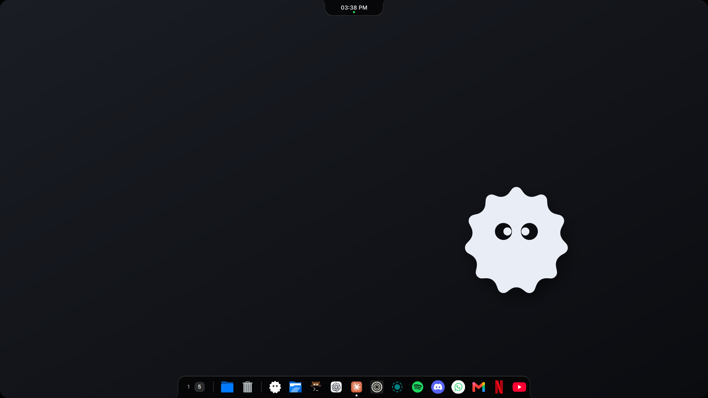
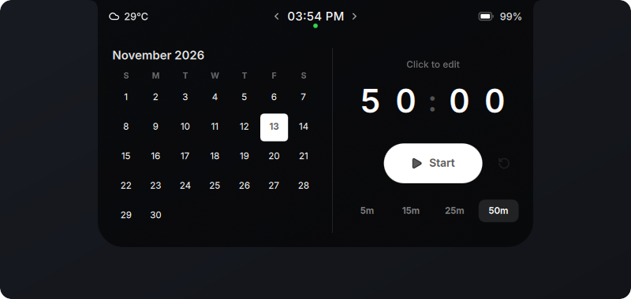
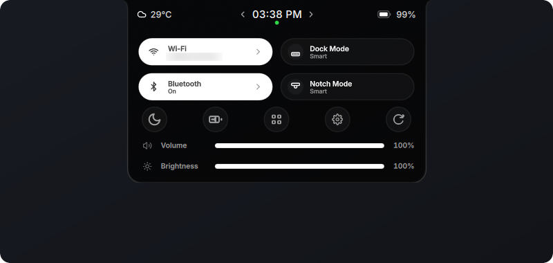
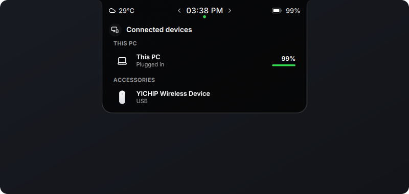
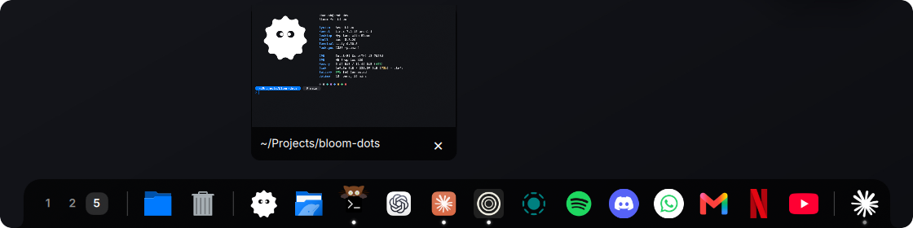
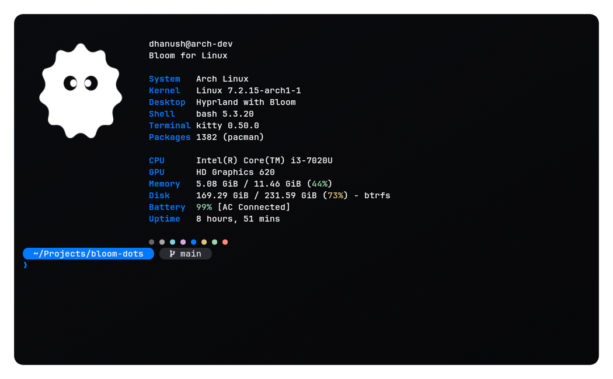
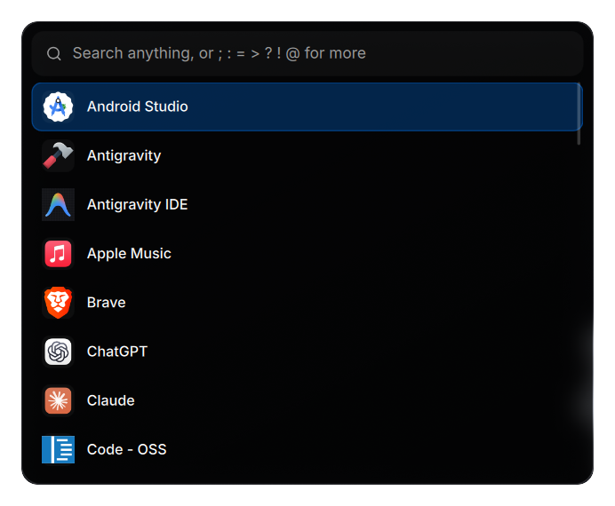
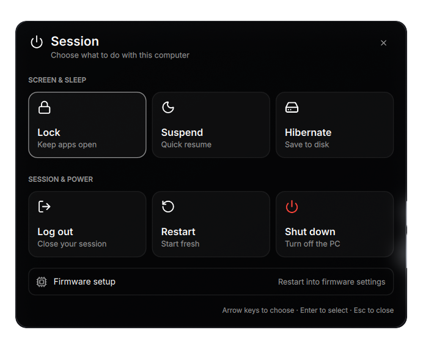
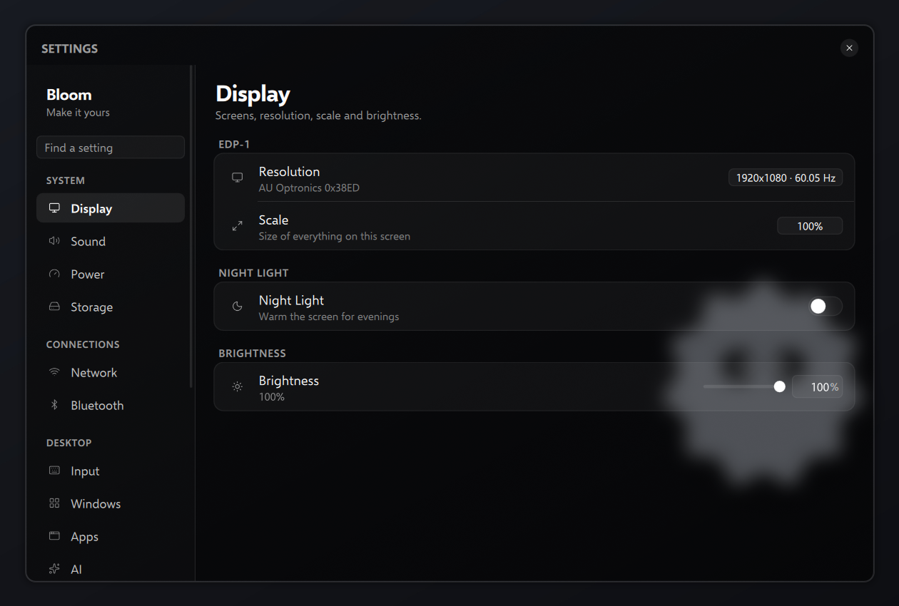
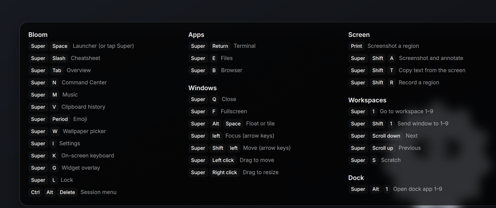

<div align="center">


# Bloom for Linux

**Your desktop, brought to life.**

The official Bloom desktop shell and dotfiles for Arch Linux and Hyprland.

[Get It Running](#get-it-running) · [Features](#the-island) · [Installation & Recovery](docs/INSTALL.md) · [Bloom for Windows](https://github.com/SehajveerSingh2005/bloom)

</div>

---

Bloom makes your Linux desktop feel alive.

A notch that opens into your music, calendar and controls. A dock that follows
your work. Notifications, search and Settings that feel like parts of the same
desktop.

`bloom-dots` is the official Linux member of the **Bloom product family**, alongside
[the original Bloom for Windows](https://github.com/SehajveerSingh2005/bloom).
The same visual identity, interactions and attention to motion, built around
Linux's desktop services.

<video width="1920" height="1080" src="https://github.com/user-attachments/assets/db395911-1dc6-41dc-9db1-41e4a1381591" controls muted></video>

<p align="center">
  
</p>

---

## The Island

A notch at the top of your screen that adapts to what you're doing.

**Music** — album art, track information, playback controls and an audio visualizer.

**Command Center** — Wi-Fi, Bluetooth, power controls, Do Not Disturb, volume
and brightness.

**Status** — battery, weather, system activity and device alerts.

**Calendar** — your month, a focus timer and todos, within reach.

**Shelf** — a place for files and text you want to keep close.

Choose **Fixed**, **Smart** or **Peek** behavior. Open the panels you need, then
let the island settle back into your desktop.

<p align="center">
  
  
  
</p>

---

## The Dock

Your apps and workspaces, together.

Pin your favorites. Drag to reorder. Hover for window previews. Right-click
for app actions and custom icons.

Fixed mode reserves room for your app windows. Smart mode gets out of their
way. Peek mode keeps the dock at the screen edge until you need it.

<p align="center">
  
</p>

---

## The Rest of Your Desktop

**Search** — launch apps, find files and windows, calculate, search the web,
restore clipboard entries and pick emoji. AI chat lives in the same launcher,
with a key you provide.

**Notifications** — cards slide in from the top-right corner, then tuck away.
Return to the edge for history, expand the stack or clear it.

**Settings** — display, sound, power, network, Bluetooth, input and desktop
appearance, alongside Bloom's own controls. Separate UI and font scales,
exact numeric values, keyboard navigation and live previews.

**System surfaces** — a lock screen, session menu, authentication prompts,
system tray, workspace overview and keybinding cheatsheet.

**Tools** — screenshots, annotation, OCR, translation, screen recording,
wallpaper selection, an on-screen keyboard and a widget overlay.

**Terminal** — kitty with a blurred background, Bloom's prompt and fastfetch
with the Bloom logo in every new window.

<p align="center">
  
</p>

<p align="center">
  
  
</p>
<p align="center">
  
</p>
<p align="center">
  
</p>

---

## Under the Hood

Built with **Quickshell and Qt Quick**, with native Linux services doing the work.

PipeWire handles audio. NetworkManager handles networks. BlueZ handles Bluetooth.
UPower reports battery status. Hyprland supplies windows and workspaces.

Bloom's surfaces share their theme, typography and motion. Reduced motion and
a low-power mode let you tune the experience to your desktop.

The installer records what it changes, preserves your custom configuration and
keeps backups. Updates, rollback and uninstall use that same record.

---

## Get It Running

**Supported platform:** Arch Linux. Bloom installs everything else it needs
itself: Hyprland, Quickshell, its own packages, the SDDM login screen and the
services its controls use. You only need `git`.

**On a fresh Arch install (archinstall, before the first boot):** after
archinstall finishes, choose to chroot into the new system (or run
`arch-chroot /mnt`), then, replacing `you` with the account you created:

```sh
pacman -S --needed git
git clone https://github.com/little-systems/bloom-dots /home/you/.local/share/bloom
/home/you/.local/share/bloom/bin/bloom install
exit
reboot
```

The machine boots to the Bloom login screen; logging in finishes the setup.
Bloom is then the whole desktop: every surface is on, Bloom's shortcuts are set
(press Super+/ to see them all), and a terminal, file manager, browser, text
editor, image viewer and video player are installed.

**On an Arch system you already use** (as your own user, not root):

```sh
git clone https://github.com/little-systems/bloom-dots ~/.local/share/bloom
~/.local/share/bloom/bin/bloom install
```

The installer shows what it will change, asks before starting, and asks for
your password once for the system part (`--dry-run` shows the plan and changes
nothing). Undo everything with `bloom uninstall`.

Without another shell, a new installation turns every surface on; next to
illogical-impulse it starts with the notch and dock. Open **Bloom Settings** to
choose surfaces and configure shortcuts. When another shell or
notification daemon is running, choose which service should own each surface
before enabling replacements.

Read [installation and recovery](docs/INSTALL.md) for requirements, customization,
updates, rollback and uninstall. What changed in each release is in the
[changelog](CHANGELOG.md).

```sh
bloom settings
bloom doctor
bloom update
bloom update --rollback
```

---

## One Bloom Family

| Product | Desktop |
| --- | --- |
| [Bloom](https://github.com/SehajveerSingh2005/bloom) | The original Bloom for Windows |
| [Bloom for Linux](README.md) | The official Arch Linux / Hyprland shell and dotfiles in this repository |

Each product uses its platform's native services while sharing Bloom's design
and interaction language.

---

## Contributing

Found a bug? Open an issue with your Bloom revision, Hyprland and Quickshell
versions, and steps to reproduce it. Remove personal information from logs.

Have an idea? Open a feature request so we can agree on the behavior and keep
it consistent across the Bloom family.

For development:

- [UI and motion conventions](docs/ui-parity.md)
- [Design specification](docs/specs/2026-10-25-bloom-shell-design.md)
- Focused installer checks: `bash tests/cli/test_lifecycle.sh`
- Complete CI gate: `CI=true tests/run-all.sh`

Tests use disposable configuration and isolated compositors. GitHub CI runs the
checks in Arch Linux. See [the installation guide](docs/INSTALL.md#development)
for the development workflow.

Licensed under [GPLv3](LICENSE). Bundled third-party notices live in [licenses](licenses/) (Lucide icons and the OFL fonts: Inter, Selawik, Syne). Demo video music: "Free (rock instrumental)" by Starfish Stories, licensed under [CC BY 3.0](https://creativecommons.org/licenses/by/3.0/).

---

<div align="center">

**Your desktop is waiting.**

</div>
